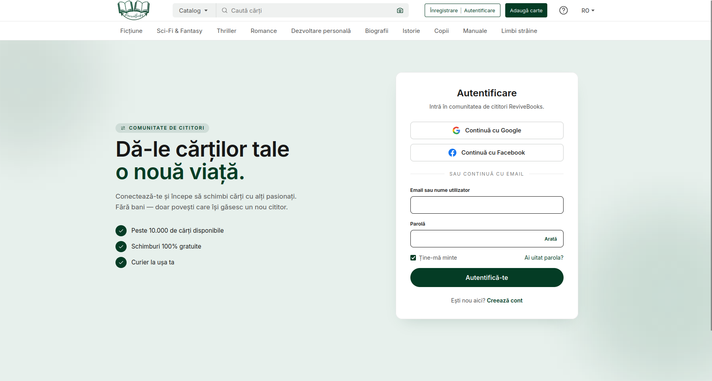
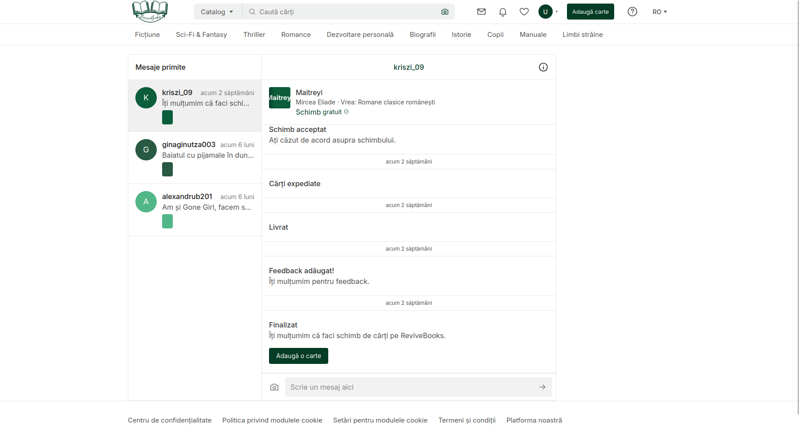
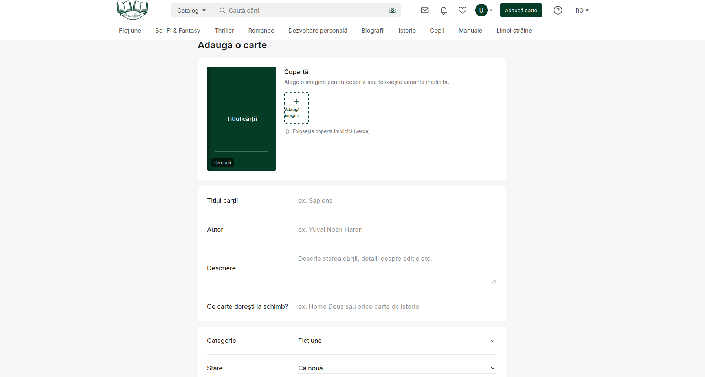

# 📚 ReviveBooks – Platformă de Schimb de Cărți Între Cititori

**ReviveBooks** este o aplicație web modernă de tip marketplace/comunitate, dedicată pasionaților de lectură care vor să ofere o a doua viață cărților din bibliotecile personale prin intermediul schimbului direct.

---

## ✨ Caracteristici principale

- **Explorare și căutare avansată:** filtrare rapidă a cărților după categorii (Ficțiune, Dezvoltare Personală, Sci-Fi etc.) și căutare dinamică după titlu, autor sau gen.
- **Sistem de favorite:** posibilitatea de a adăuga cărți la favorite pentru a le urmări mai târziu.
- **Detalii complete și previzualizare:** pagină dedicată pentru fiecare carte, incluzând starea fizică și profilul utilizatorului care a postat-o.
- **Profiluri de utilizator:** vizualizarea raftului și a recenziilor altor cititori din comunitate.
- **Chat și livrare:** cameră de chat integrată între utilizatori și flux interactiv de confirmare a schimbului, urmat de generarea detaliilor de livrare / AWB.
- **Adăugare / editare anunțuri:** formulare intuitive pentru publicarea sau modificarea cărților puse la schimb.

---

## 🛠️ Tehnologii folosite

| Categorie | Tehnologie |
| :--- | :--- |
| Framework frontend | [Vue.js](https://vuejs.org/) (Composition & Options API) + Vue Router |
| Styling | [Tailwind CSS](https://tailwindcss.com/) – design modern, curat și responsive |
| Iconițe | [`lucide-vue-next`](https://lucide.dev/) |
| Build tool | [Vite](https://vitejs.dev/) |

---

## 📱 Previzualizare

| Ecranul principal (Home) | Pagina de login |
| :---: | :---: |
|  |  |

| Camera de chat | Adăugare carte |
| :---: | :---: |
|  |  |

---

## 🚀 Cum rulezi aplicația local

### Cerințe

- [Node.js](https://nodejs.org/) (versiunea LTS recomandată)
- npm

### 1. Clonează repository-ul

```bash
git clone https://github.com/nume-utilizator/ReviveBooks.git
cd ReviveBooks
```

### 2. Instalează dependențele

```bash
npm install
```

### 3. Pornește serverul de dezvoltare

```bash
npm run dev -- --host
```

- Aplicația rulează implicit la adresa: `http://localhost:3000`
- Pentru a o accesa de pe telefon (în aceeași rețea Wi-Fi), folosește adresa **Network** afișată în terminal, de exemplu `http://192.168.x.x:3000`.

### 4. Construiește pentru producție

```bash
npm run build
```

Fișierele optimizate vor fi generate în folderul `dist/`.

---

## 📄 Licență

Acest proiect este dezvoltat în scop educativ și pentru portofoliu personal.
